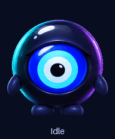

# Nazar

Nazar is an installed custom ChatGPT pet. Its visible behavior comes from an animated PNG sprite sheet. This kit contains the actual art, individual frames, prompts, layout guides, previews, validation reports, and Python and PowerShell tooling used to build and check that sheet.

| Location | Contents |
|---|---|
| final/spritesheet-extended.png | Installed image at the time this kit was made |
| decoded/ | Editable ImageGen source strips and canonical artwork |
| frames/ | Registered standard animation frames |
| prompts/ and references/ | Generation prompts, canonical and layout references |
| previews/ | Full motion, individual states, jump transition, and gaze loop |
| qa/ | Prior visual decisions, validator outputs, and preview tooling |
| pipeline/ | Bundled Pets scripts and contracts plus Nazar’s baseline registration helper |

## Quickest way to update it in ChatGPT

Attach this kit or point Codex at its extracted folder, then use the Pets plugin with a prompt like this.

> Use the Pets update-pet skill to update my existing custom pet Nazar. Use my Nazar update kit as the source. I want [describe the changes]. Preserve the existing pet ID. For artwork changes, show me the revised motion and validate the exact sprite sheet before applying the update.

For a name or description change, give the new wording. The Pets update tool can change that metadata directly. To revise the art, the workflow first fetches the current stored sprite sheet, which may contain updates made after this kit was exported.

## Rebuild the image locally

Use PowerShell 7, Python 3.10 or later with Pillow, and FFmpeg if you want to generate the MP4 preview. The original build used Pillow 12.3.0. From the repository root, run the following command with a fresh output directory.

    pwsh -NoProfile -File .\Rebuild-Nazar.ps1 -OutputDir .\revision-01

The script rebuilds the PNG from the source strips in decoded/, emits two review sheets, and checks the structural requirements. It performs local file operations only.

For an art change, replace the affected source strip in a working copy of decoded/ and rebuild. The original prompts and layout guides identify the required frame counts. Use the current pet atlas and the canonical artwork as identity references when generating replacement visuals, then review the new sprite at normal pet size. If you change the gaze, rebuild the affected eight-pose look row together so adjacent poses retain the same silhouette and move clockwise consistently. See pipeline/references/sprite-sheet-contract.md for the full review sequence.

The shipping sheet is a transparent 1536 × 2288 PNG with 192 × 208 cells. It has nine state rows and two gaze rows. The fifteen unused cells are transparent. Reference previews and semantic reports describe the included original art. Make new previews and visual judgments for each revised sheet.

## Apply the revised pet

The Pets plugin validates the exact encoded PNG before its upload-session tool transfers it. Pass that session to update_pet using the existing Nazar pet ID, then verify it and the active selection. See pipeline/skills/update-pet/SKILL.md and pipeline/references/upload-session.md for the full sequence.

The original sprite SHA-256 is 186a80f11602a007ab8fd4801dcbca8f899ee84b59bafd580a2563fa59dd85ea.
